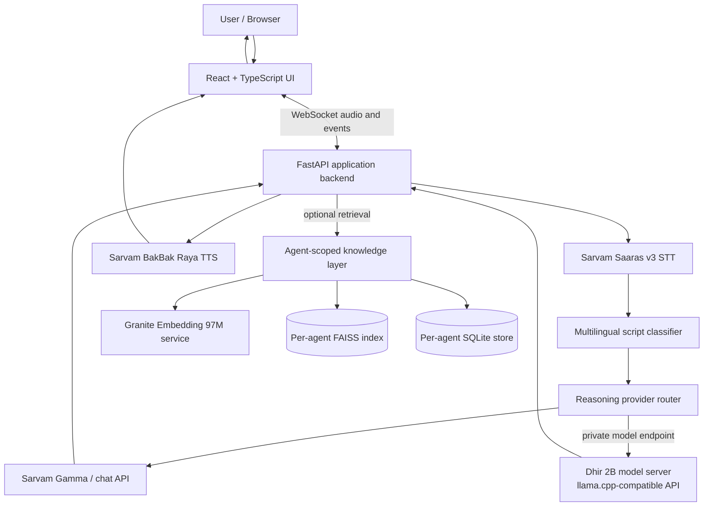

# AURA — Self-Hosted Multilingual Voice AI


<p align="center">
  <strong>A real-time voice AI playground combining multilingual speech, model serving, and agent-specific retrieval.</strong>
</p>

<p align="center">
  <a href="https://sarvam-voice-agent.pages.dev/">Live application</a> ·
  <a href="https://github.com/abhinavnautiyalDS/sarvam-voice-agent">Source code</a>
</p>

AURA is an actively evolving engineering project for building and operating a multilingual voice assistant. It brings together speech recognition, language/script handling, selectable reasoning backends, speech synthesis, and optional knowledge-base retrieval. A key project goal is to understand and control the system end to end—including model serving, backend orchestration, storage, networking, and deployment—instead of treating the experience as a single external API call.

> **Project status:** In active development. The live application and repository may not expose every experimental, infrastructure-only, or planned capability described here. This README documents the architecture and configuration represented by this branch and the current project handover; it is not a claim that every optional path is production-hardened.

## Contents

- [At a glance](#at-a-glance)
- [System architecture](#system-architecture)
- [Voice request lifecycle](#voice-request-lifecycle)
- [Models and services](#models-and-services)
- [Reasoning model history and API compatibility](#reasoning-model-history-and-api-compatibility)
- [Language and script handling](#language-and-script-handling)
- [Knowledge base and RAG](#knowledge-base-and-rag)
- [Infrastructure and deployment](#infrastructure-and-deployment)
- [Configuration](#configuration)
- [Run locally](#run-locally)
- [Knowledge-base operations](#knowledge-base-operations)
- [Security notes](#security-notes)
- [Known limitations](#known-limitations)
- [Roadmap](#roadmap)

## At a glance

| Area | Technology / approach |
|---|---|
| Live web application | [AURA on Cloudflare Pages](https://sarvam-voice-agent.pages.dev/) |
| Frontend | React, TypeScript, Vite (frontend deployment) |
| Application backend | Python, FastAPI, Uvicorn |
| Browser audio transport | WebSocket voice endpoint and browser audio capture/playback |
| Speech-to-text | Sarvam Saaras v3 realtime |
| Language/script signal | Fine-tuned multilingual BERT-Tiny classifier |
| Hosted reasoning option | Sarvam Gamma / configured Sarvam chat-completions model |
| Self-hosted reasoning option | Dhir 2B, GGUF Q4_K_M, served through the existing llama.cpp-compatible model-server path |
| Text-to-speech | Sarvam BakBak Raya |
| Embeddings | IBM Granite Embedding 97M Multilingual R2 |
| Vector search | FAISS |
| Metadata and document records | SQLite |
| Private service connectivity | Tailscale between cloud services |
| Frontend hosting | Cloudflare Pages |

## System architecture

AURA is composed of independently deployable layers. The browser handles the user experience and audio I/O; the application backend coordinates a voice session and protects credentials; model services provide inference; and the knowledge-base layer supplies optional agent-scoped context.



The diagram is a logical view. It does not imply that every request uses RAG or that all model components run on the same machine. The self-hosted embedding and reasoning services are separate from the browser-facing application backend.

### Main components

1. **Frontend:** provides the browser playground, session controls, audio capture/playback, and visibility into the voice interaction.
2. **Application backend:** owns the session, receives browser audio over the voice WebSocket, coordinates STT/classification/reasoning/TTS, and keeps private credentials server-side.
3. **Speech and reasoning providers:** STT, the selected reasoning backend, and TTS are separate stages and can be configured independently.
4. **Model-serving layer:** hosts self-managed inference endpoints that are reachable privately by the backend.
5. **Knowledge layer:** performs optional retrieval against the selected agent's own indexed documents.
6. **Embedding service:** converts source chunks and search queries into 384-dimensional vectors using Granite.

## Voice request lifecycle

The browser voice experience follows this high-level flow:

1. The user grants microphone access and starts a voice session.
2. The browser captures audio and streams it to the backend over the voice WebSocket.
3. The backend forwards speech to Sarvam Saaras v3 realtime STT.
4. The finalized transcript is passed through the language/script-classification step.
5. The backend selects the configured reasoning provider (Sarvam or the self-hosted model path).
6. If knowledge retrieval is enabled for the active agent and the request needs organization-specific information, the backend retrieves relevant chunks from that agent's knowledge base and supplies the context to the reasoning stage.
7. The generated response is sent to BakBak Raya for speech synthesis.
8. The backend returns response events/audio to the browser for playback and inspection.

The system also exposes diagnostic information in the playground, including transcript and model-stage information/latency where available. A successful WebSocket connection by itself should not be interpreted as proof that microphone frames reached STT; inspect the audio-flow and stage events.

## Models and services

### Speech-to-text — Sarvam Saaras v3

- Used for realtime speech recognition in the browser voice pipeline.
- The configured model identifier is `saaras:v3-realtime`.
- STT model and endpointing options are controlled through the `SARVAM_STT_*` configuration family.
- The backend receives transcript events and passes finalized text to subsequent stages.

### Language/script classifier — fine-tuned BERT-Tiny

The classifier is used as a lightweight signal for language/script-aware response routing.

- The checked-in browser application path uses the fine-tuned BERT-Tiny classifier.
- It predicts dominant writing script, notably `DEVANAGARI` and `LATIN`, and exposes the corresponding softmax scores and inference timing.
- Model artifacts are maintained in the [hinglish-language-switch-llm repository](https://github.com/abhinavnautiyalDS/hinglish-language-switch-llm/tree/script-classifier-dataset/artifacts/script_classifier_bert_tiny/model) and are fetched lazily/cached by the application as described by the implementation.
- The classifier is a script classifier, not a complete semantic language identifier. Latin-script Hindi/Hinglish may be classified as Latin and cannot reliably be distinguished from English using script alone.
- Softmax outputs are model scores, not necessarily calibrated probabilities.

The project has experimented with multiple language-identification approaches. The README describes the BERT-Tiny path represented in this branch, not every historical experiment.

### Reasoning — Sarvam Gamma

Sarvam is the default reasoning provider in the hosted voice configuration.

- Uses the configured Sarvam chat-completions model through the Sarvam API.
- The repository configuration supports model IDs such as `sarvam-105b-conversations` and `sarvam-105b`, subject to API account access.
- The browser does not need to hold provider credentials; requests are coordinated by the backend.

### Reasoning — self-hosted Dhir 2B

AURA also has a self-hosted reasoning path using **Dhir 2B**.

- Model artifact: `dhir-2b-Q4_K_M.gguf`
- Quantization: GGUF Q4_K_M
- Inference runtime/API compatibility: existing llama.cpp-compatible model-server setup
- Connectivity: private backend-to-model-server network path (Tailscale in the deployed setup)

This model path is intended to provide a self-hosted reasoning option. The model server is not a browser-facing service; the backend mediates requests and protects its credentials.

### Text-to-speech — Sarvam BakBak Raya

- Generates spoken responses for the browser voice session.
- The configured voice/model default in the repository is BakBak Raya `m1`.
- The voice ID is account-configured using `BAKBAK_VOICE_ID`.
- Audio is returned to the browser for playback.

### Embeddings — IBM Granite Embedding 97M Multilingual R2

AURA uses a self-hosted embedding service rather than relying on a paid hosted embedding API for its RAG vectorization path.

| Property | Configuration |
|---|---|
| Model | IBM Granite Embedding 97M Multilingual R2 |
| Embedding dimension | 384 |
| Maximum input length | 512 tokens (service configuration) |
| Maximum batch size | 16 (service configuration) |
| Runtime format | ONNX |
| Quantized artifact | `model_quint8_avx2.onnx` |
| Vector store | FAISS |

The embedding API is exposed privately to the application backend. The configured endpoint path is `POST /embed`, accepting a JSON body containing a `texts` array and authenticating with `X-API-Key`.

## Reasoning model history and API compatibility

The self-hosted reasoning infrastructure was initially set up around **Qwen3 0.6B**. That model did not provide the Hindi/multilingual behavior required for the intended conversational experience, so the model weights were changed to **Dhir 2B**.

An important implementation detail:

- The original model-server and backend integration were built around the Qwen deployment.
- The later change replaced the model artifact/path loaded by the existing inference service.
- The surrounding serving pipeline, API-compatible interface, service integration, and backend call path were retained rather than redesigned.
- Consequently, some environment-variable names, API aliases, or service labels still contain `QWEN` / `qwen`. Those are legacy compatibility names and **do not prove that Qwen weights are currently loaded**.
- The actual loaded model artifact is Dhir 2B when the model-server configuration points to `dhir-2b-Q4_K_M.gguf`.

Do not infer the loaded model from an API alias alone. Verify the model path configured on the model-serving instance.

## Language and script handling

The browser pipeline uses classifier output to guide response-language behavior. The current documented labels include:

| Label | Intended behavior |
|---|---|
| `english` | Set/maintain English response behavior |
| `hinglish` | Respond naturally in Hinglish |
| `neutral` | Preserve the current conversation language; do not switch because of short acknowledgements |
| `uncertain` | Preserve the current language and clarify only when necessary |
| `other` | Use the configured Hindi/English-only fallback |

The exact routing logic is implemented in the application. The classifier's `DEVANAGARI`/`LATIN` output is a writing-script signal, so it should not be described as perfect Hindi-versus-English detection. In particular, Romanized Hindi/Hinglish remains a known ambiguity.

## Knowledge base and RAG

AURA includes an optional knowledge-base subsystem with isolated stores for each agent. Its purpose is to ground agent responses in supplied documents when the question requires domain-specific information.

### Agent identities

| Agent ID | Display purpose | Source folder |
|---|---|---|
| `general` | General Assistant | `backend/knowledge_sources/general/` |
| `customer_service` | Admission Counsellor | `backend/knowledge_sources/admission_counsellor/` |
| `tutor` | AI Tutor | `backend/knowledge_sources/ai_tutor/` |

### Checked-in demonstration sources

- General Assistant: `backend/knowledge_sources/general/friendly_companion_reference.md`
- Admission Counsellor: `backend/knowledge_sources/admission_counsellor/dv_university_admissions_handbook.md`
- AI Tutor: `backend/knowledge_sources/ai_tutor/ml_ai_learning_curriculum.md`

**Important:** The DV University handbook is fictional demonstration content. It is not Delhi University material and is not affiliated with Delhi University. Its example courses, eligibility details, and fees must not be represented as official university information.

### Per-agent data isolation

Each agent has its own SQLite database and FAISS index:

```text
data/
└── knowledge_base/
    ├── general/
    │   ├── knowledge.sqlite3
    │   └── knowledge.faiss
    ├── customer_service/
    │   ├── knowledge.sqlite3
    │   └── knowledge.faiss
    └── tutor/
        ├── knowledge.sqlite3
        └── knowledge.faiss
```

The runtime `data/knowledge_base/` directory is excluded from Git. The previous root-level Gemini-era store, if present, is not the active Granite-backed agent store and is not automatically migrated or removed by the agent-isolated implementation.

### Indexing and retrieval behavior

- Source Markdown is distinct from the generated runtime vector index.
- The Knowledge Base source browser can display original Markdown; reading a source file does not mean it has been embedded or indexed.
- Indexing is performed per agent. Re-indexing a source replaces that source's record in the same agent store and does not update another agent's store.
- Retrieval is independently disabled by default for each agent. Index and verify the intended agent's sources before enabling retrieval.
- The voice path passes the active agent identity to the KB layer, keeping General Assistant, Admission Counsellor, and AI Tutor retrieval scoped to their own stores.
- If the KB service is unavailable, the voice pipeline is designed to log the retrieval failure without taking down the complete voice interaction.

### Knowledge API surface

The branch README documents these agent-scoped endpoints:

| Method | Endpoint | Purpose |
|---|---|---|
| GET | `/api/knowledge/sources?agent=general` | Read checked-in source content |
| GET | `/api/knowledge/status?agent=general` | Read agent KB status |
| GET | `/api/knowledge/documents?agent=general` | List indexed documents |
| GET | `/api/knowledge/documents/{document_id}/chunks?agent=general` | Inspect document chunks |
| PUT | `/api/admin/knowledge/enabled?agent=general` | Enable/disable retrieval for an agent |
| POST | `/api/admin/knowledge/index-sources?agent=general` | Index that agent's checked-in sources |

Replace `general` with `customer_service` or `tutor` where appropriate. Administrative endpoints are protected; the backend configuration uses `AURA_ADMIN_ALLOWED_IPS` for the allowed caller IPs.

## Infrastructure and deployment

The deployed system separates the browser frontend, application backend, and private model-serving services.

### Logical deployment layout

```text
Browser
  |
  | HTTPS / WSS
  v
Cloudflare Pages
  |
  | HTTPS API + secure WebSocket
  v
Application Backend (AWS EC2)
  |-- FastAPI / Uvicorn
  |-- Voice session orchestration
  |-- Knowledge Base API and agent routing
  |
  | private Tailscale connectivity
  +-------------------------+
  |                         |
  v                         v
Granite Embedding Service   Reasoning Model Server
(ONNX / FastAPI)            (llama.cpp-compatible API)
```

- **Frontend hosting:** Cloudflare Pages, with the frontend project rooted at `frontend/` and built using the frontend's configured build script.
- **Application backend:** AWS EC2, running the FastAPI application behind the deployed web-server/reverse-proxy configuration.
- **Model services:** separate self-hosted services for Granite embeddings and the local reasoning model.
- **Private networking:** Tailscale is used for backend-to-model-service connectivity; private model endpoints and keys should not be exposed in frontend configuration.
- **Service management:** the deployment has used systemd services for the application backend and model servers. Service names recorded during the project include `aura.service`, `aura-ai.service`, and the legacy `aura-qwen.service`. A service name containing `qwen` is not proof of the loaded model identity.
- **Reverse proxy:** Nginx is part of the deployed backend path.

The exact instance sizes, current public/tunnel hostnames, and active model-server command-line flags are environment-specific and are intentionally not hard-coded here. Confirm them on the running EC2 instances before changing deployment configuration.

### Frontend environment

For a frontend hosted separately from the backend, configure these Cloudflare Pages build variables:

```env
VITE_AURA_API_BASE_URL=https://<backend-host>
VITE_AURA_WS_URL=wss://<backend-host>/ws/voice
```

Use the actual stable backend hostname for the deployment. If using a temporary tunnel hostname, update both values when that hostname changes.

### Backend CORS

Set `AURA_ALLOWED_ORIGINS` on the backend to the exact deployed frontend origin, for example:

```env
AURA_ALLOWED_ORIGINS=https://sarvam-voice-agent.pages.dev
```

Do not use a wildcard origin for a credentialed browser API.

## Configuration

Configuration names below are drawn from the current branch README and project service handover. Only set the variables for the features you enable.

### Voice provider credentials

```env
SARVAM_API_KEY=<your-sarvam-api-key>
SARVAM_LLM_MODEL=sarvam-105b-conversations

BAKBAK_API_KEY=<your-bakbak-api-key>
BAKBAK_VOICE_ID=<your-bakbak-voice-id>
```

### Script classifier

```env
HF_TOKEN=<your-hugging-face-token>
LANGUAGE_CLASSIFIER_MIN_CONFIDENCE=0.60
LANGUAGE_CLASSIFIER_OVERRIDE_CONFIDENCE=0.80
```

The confidence thresholds are configuration values, not a guarantee of calibrated model confidence.

### Self-hosted reasoning provider

The deployed backend configuration retains legacy Qwen-named variables for compatibility with the original integration. Their values must point to the current model-server endpoint and configured model alias; confirm them against the active backend and model-server configuration before enabling this path.

Example shape (use deployment-specific values; do not copy placeholder values literally):

```env
QWEN_API_KEY=<model-server-api-key>
AURA_QWEN_CHAT_COMPLETIONS_URL=http://<private-model-host>:<port>/v1/chat/completions
AURA_QWEN_MODEL=<configured-model-alias>
```

The actual model weights are determined by the model path loaded by the model server. In the current project handover that artifact is `dhir-2b-Q4_K_M.gguf`, despite the legacy variable names.

### Granite embedding service

Configure the following on the **application backend only**:

```env
AURA_EMBEDDING_API_URL=http://<private-granite-host>:8080/embed
AURA_API_KEY=<shared-embedding-service-secret>
AURA_KB_DATA_DIR=data/knowledge_base
```

The embedding service expects a `POST /embed` request with JSON shaped like:

```json
{
  "texts": ["first text", "second text"]
}
```

The backend authenticates with the `X-API-Key` header. Keep this secret server-side.

### Other deployment settings

Depending on enabled features, the deployment may also use:

- `AURA_ALLOWED_ORIGINS` — exact browser origins allowed by the backend.
- `AURA_ADMIN_ALLOWED_IPS` — IP allowlist for protected knowledge-base administration.
- `CLOUDFLARE_TURN_KEY_ID` and `CLOUDFLARE_TURN_KEY_API_TOKEN` — Cloudflare Realtime TURN credentials.
- `TURN_SERVER_URL`, `TURN_SERVER_USERNAME`, and `TURN_SERVER_CREDENTIAL` — optional alternative TURN configuration.
- `VITE_AURA_API_BASE_URL` and `VITE_AURA_WS_URL` — frontend API and WebSocket origins.

Never commit real values to Git.

## Run locally

The repository includes a Streamlit-based development/browser path and a local Pipecat runner in addition to the hosted AURA frontend/backend deployment. These are distinct execution paths; do not assume every hosted feature is wired into the local runner.

### Python environment

Python 3.12 is recommended for the Streamlit/Python environment.

```bash
python -m venv .venv

# Windows PowerShell
.venv\\Scripts\\Activate.ps1

# macOS / Linux
source .venv/bin/activate

python -m pip install --upgrade pip
pip install -r requirements.txt
```

Create a local `.env` from `.env.example` and add the required credentials. The Streamlit app reads Streamlit Secrets first, then environment variables / `.env` for local development.

### Start the Streamlit browser app

```bash
streamlit run app.py
```

### Start the local Pipecat runner

For a microphone connected directly to the machine running Python:

```bash
python voice_agent.py
```

The repository's documented local Pipecat runner is separate from the hosted browser WebRTC route. The README for this branch notes that the local `voice_agent.py` runner is not wired to the BERT-Tiny classifier used by the browser route.

## Knowledge-base operations

The following commands illustrate indexing each agent's checked-in Markdown sources from the backend host. Run one request per agent, and only from an IP allowed by `AURA_ADMIN_ALLOWED_IPS`.

```bash
curl -X POST "http://127.0.0.1/api/admin/knowledge/index-sources?agent=general"
curl -X POST "http://127.0.0.1/api/admin/knowledge/index-sources?agent=customer_service"
curl -X POST "http://127.0.0.1/api/admin/knowledge/index-sources?agent=tutor"
```

Inspect an agent's status and documents before enabling retrieval:

```bash
curl "http://127.0.0.1/api/knowledge/status?agent=general"
curl "http://127.0.0.1/api/knowledge/documents?agent=general"
```

Enable retrieval only after the agent's sources have been indexed and checked:

```bash
curl -X PUT "http://127.0.0.1/api/admin/knowledge/enabled?agent=general" \
  -H "Content-Type: application/json" \
  -d '{"enabled": true}'
```

Back up each agent's SQLite and FAISS files before manual maintenance. Do not copy one agent's index into another agent's directory.

## WebRTC, TURN, and audio troubleshooting

For hosted browser sessions, STUN-only connectivity may fail on restrictive office, mobile, or NAT/firewall networks. The documented ICE configuration prefers Cloudflare Realtime TURN when both Cloudflare TURN credentials are configured, then tries Hugging Face TURN, and finally falls back to Google STUN. An alternative TURN provider can be configured using the `TURN_SERVER_*` variables.

After changing TURN credentials or ICE configuration, restart/redeploy as applicable and start a fresh voice session.

Troubleshooting checklist:

1. Confirm browser microphone permission is granted.
2. Confirm the frontend is configured with the correct HTTPS API base URL and WSS voice URL.
3. Check that the backend reports incoming microphone frames; “session started” alone does not prove that audio is flowing.
4. Inspect the raw STT event/transcript.
5. Inspect classifier output and remember that Latin-script Hinglish is an inherent ambiguity for a script-only classifier.
6. Inspect reasoning-provider response and latency.
7. Inspect the TTS response and browser audio playback/sample-rate handling.
8. If the browser cannot establish media connectivity, inspect ICE candidate/TURN configuration and backend CORS/origin settings.
9. If RAG is expected, verify the selected agent, indexed document list, retrieval-enabled flag, embedding service health, and agent-specific FAISS/SQLite files.

## Security notes

- Never commit `.env`, Streamlit secrets, API keys, model-server credentials, TURN credentials, or private service tokens.
- Do not expose model-server or embedding-service private endpoints directly to the browser.
- Keep all provider credentials on the backend or the relevant model host.
- Restrict administrative KB endpoints with the configured IP allowlist.
- Do not use wildcard CORS origins for credentialed browser requests.
- Do not commit runtime FAISS indexes, SQLite KB databases, private call transcripts, or user audio.
- Use consented and appropriately anonymized audio/transcripts when evaluating classifier behavior on real traffic.

## Known limitations

- AURA is an evolving project, not a claim of production readiness or guaranteed low-latency performance under all network conditions.
- BERT-Tiny predicts dominant script; it does not reliably separate English from Romanized Hindi/Hinglish.
- Classifier softmax scores are not guaranteed to be calibrated confidence values.
- The local Pipecat runner and hosted browser voice route do not necessarily have identical classifier or KB integration.
- Knowledge retrieval is optional and agent-scoped; checked-in source files are not automatically proof of successful indexing.
- Self-hosted model availability and behavior depend on the actual model artifact, server configuration, machine resources, and private network connectivity.
- Legacy Qwen-named API/configuration labels remain in parts of the self-hosted reasoning integration even though the configured model weights were changed to Dhir 2B.

## Roadmap

Areas for continued development and validation:

- Improve language/script routing for Romanized Hindi and code-mixed utterances.
- Evaluate language routing against consented, anonymized transcripts from the target speech-recognition pipeline.
- Measure and optimize end-to-end voice latency across STT, classification, reasoning, retrieval, and TTS.
- Validate the self-hosted Dhir model path and its resource/performance profile under realistic concurrent sessions.
- Improve observability for audio flow, provider failures, per-stage latency, and retrieval outcomes.
- Expand agent-specific knowledge-base evaluation, indexing checks, and retrieval quality tests.
- Harden deployment, service health checks, backups, and operational documentation.

## Acknowledgements

- [Sarvam AI](https://www.sarvam.ai/) — speech and language services used in the voice pipeline.
- [IBM Granite](https://huggingface.co/ibm-granite/granite-embedding-107m-multilingual) — multilingual embedding model family.
- [FAISS](https://github.com/facebookresearch/faiss) — vector similarity search.
- [Hugging Face](https://huggingface.co/) — model artifact hosting and tooling.

---

**AURA is built as a learning-by-building project:** experimenting with multilingual voice interaction, self-hosted inference, retrieval systems, and the infrastructure required to connect them into one working application.
